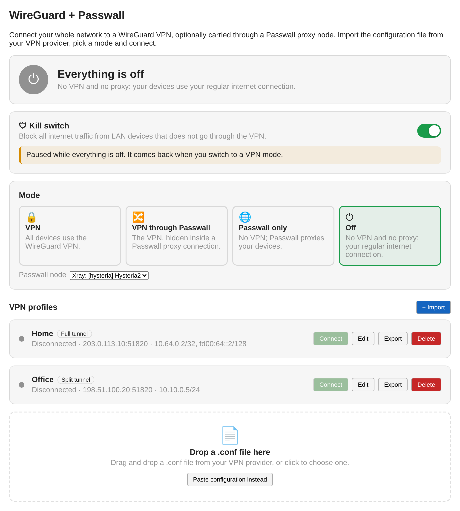

# WireGuard + Passwall (luci-app-wireguard-passwall)

A simple WireGuard VPN **client** for OpenWrt's LuCI web interface that can also carry the VPN through a [Passwall](https://github.com/Openwrt-Passwall/openwrt-passwall) proxy node.

- **Import** the `.conf` file from your VPN provider (drag & drop, file picker or paste) with a live check of the file before saving
- **One-click connect / disconnect**, only one profile is active at a time
- **Live status**: handshake, uptime, traffic, server and tunnel address
- **Kill switch** toggle: LAN devices can only reach the internet through the VPN
- Edit, export and delete profiles; works on desktop and phone
- **Modes** (with Passwall installed): VPN, VPN carried through a Passwall node, Passwall only, and Off, switched with one click (see below)

Built and tested for **OpenWrt 25.12** (apk package manager).

<p align="center">
  
</p>

| Import with a live check | Everything off | On a phone |
|---|---|---|
|  |  |  |

<sub>Screenshots show sample data; colours and fonts follow your LuCI theme.</sub>

## Install on your router

1. Get the package
   - From the [Releases](../../releases) page (a release is published on every merge into `main`), or
   - From the **Actions** tab → latest *Build package* run → artifact `luci-app-wireguard-passwall-openwrt-25.12.2` (it's a zip with the `.apk` inside).
2. Copy it to the router (`-O` is needed because OpenWrt has no SFTP server by default):
   ```sh
   scp -O luci-app-wireguard-passwall-*.apk root@192.168.1.1:/tmp/
   ```
3. Install it on the router. The package is built by CI, not signed by OpenWrt, so allow it explicitly:
   ```sh
   ssh root@192.168.1.1
   apk update
   apk add --allow-untrusted /tmp/luci-app-wireguard-passwall-*.apk
   ```
   `apk update` lets apk pull the dependencies it doesn't find on the router (`wireguard-tools`, `kmod-wireguard`, the ucode modules, ...) from the official feeds, so the router needs internet access for the install.
4. **Log out of LuCI and log back in**, then open **VPN → WireGuard + Passwall**. LuCI decides which menu entries you may see when you log in, so an already open session won't show the new entry.

### Installing from LuCI (signed packages)

OpenWrt only trusts packages signed with a key in `/etc/apk/keys`. Unsigned self-built packages fail with `UNTRUSTED signature` unless `--allow-untrusted` is passed, which LuCI's **Upload Package…** dialog cannot do. CI therefore signs the package with your own key:

**Once, on GitHub:** create a signing key on your computer and store it as a repository secret.

```sh
openssl ecparam -name prime256v1 -genkey -noout -out apk-signing-key.pem
```

GitHub → repository → *Settings → Secrets and variables → Actions → New repository secret*: name `APK_SIGNING_KEY`, value: the contents of `apk-signing-key.pem`. Keep the file somewhere safe and private. Every build after that is signed, and the artifact / release additionally contains `wireguard-passwall.pem` (the public key) and `packages.adb` (a signed package index).

**Releases:** every merge into `main` publishes a GitHub release `v<PKG_VERSION>-r<N>` (e.g. `v1.1.0-r45`), where `N` is the number of commits on `main`, set automatically by CI; only bump `PKG_VERSION` in the Makefile for a new version. Each release contains the signed `.apk`, `packages.adb` (the signed package list a router reads when the release is used as a feed) and the public key `wireguard-passwall.pem`. The latest release's files are always at:

```
https://github.com/willhuang85/luci-wireguard/releases/latest/download/<file>
```

**Once, on the router:** trust the public key.

```sh
wget -O /etc/apk/keys/wireguard-passwall.pem \
  https://github.com/willhuang85/luci-wireguard/releases/latest/download/wireguard-passwall.pem
```

Then install from **System → Software → Upload Package…** (download the `.apk` from the release first) with no extra flags. Or, to have the app show up and update in *System → Software* like any other package, add the release as a package feed:

```sh
echo "https://github.com/willhuang85/luci-wireguard/releases/latest/download/packages.adb" >> /etc/apk/repositories.d/customfeeds.list
```

and use *System → Software → Update lists*, search for `luci-app-wireguard-passwall`, *Install*.

> The `wget` and feed commands need the repository to be **public**: GitHub only serves a private repository's release files to logged-in users, and the router cannot log in. With a private repository, download `wireguard-passwall.pem` and the `.apk` from the release page in your browser, then `scp -O wireguard-passwall.pem root@192.168.1.1:/etc/apk/keys/` and use *Upload Package…*.

### Troubleshooting

- **Installed but no menu entry** – log out of LuCI and back in (and reload the page with Ctrl+F5). Still nothing? Check `apk info -e luci-app-wireguard-passwall`, run `/etc/init.d/rpcd restart` and verify `ubus list luci.wgpasswall` prints the object.
- **`UNTRUSTED signature`** – the package is unsigned (no `APK_SIGNING_KEY` secret) or the router lacks the public key in `/etc/apk/keys`; see *Installing from LuCI* above, or use `apk add --allow-untrusted`.
- **`wget ... Failed to send request: Operation not permitted`** during `apk update` – the router itself cannot reach the package mirror; a firewall rule is dropping the router's own outgoing traffic (not related to this app). `apk` needs the mirror to fetch `wireguard-tools` and `kmod-wireguard`. Check with:
  ```sh
  ping -c 3 1.1.1.1                 # basic connectivity
  nslookup downloads.openwrt.org    # DNS
  ip rule                           # look for "prohibit"/"blackhole"
  nft list ruleset | grep -inE 'drop|reject' | head -30
  ```
  If a proxy app such as Passwall runs with "Localhost proxy", stop it briefly (`/etc/init.d/passwall stop`), run `apk update`, install, then start it again.

To uninstall: `apk del luci-app-wireguard-passwall` (the kill switch is turned off automatically so you don't lose internet access).

## Using it

1. Click the drop zone or **+ Import**, pick your `.conf` file, give it a name.
2. Check the preview ("Looks good", server, routing) and press **Save & connect**.
3. Optional: turn on the **Kill switch**.

The status card turns green once the server answered with a handshake. A profile that is connected stays connected after a reboot.

### What the kill switch does

When on, a firewall rule rejects all traffic forwarded from the `lan` zone to the `wan` zone. Traffic to the VPN zone is still allowed, so:

- VPN connected → everything works through the tunnel.
- VPN drops or is disconnected → LAN devices have **no internet** until a VPN connects again. Nothing leaks over your normal connection.

The router itself can still reach the internet (it needs that to contact the VPN server), and access to LuCI/SSH from the LAN is not affected. The zone names can be changed in `/etc/config/wgpasswall` if yours differ from `lan`/`wan`.

### Good to know

- **DNS**: the DNS servers from the `.conf` are added to the router's resolver, but the router's dnsmasq may still also use your ISP's DNS servers. For strict DNS privacy, set the VPN's DNS server under *Network → DHCP and DNS → Forwards* and disable *Use DNS servers advertised by peer* on the `wan` interface.
- **IPv6**: if your provider's config only contains IPv4 `AllowedIPs`, LAN IPv6 traffic bypasses the VPN unless the kill switch is on.
- `PreUp`/`PostUp`/`Table` lines from wg-quick have no meaning on OpenWrt and are ignored (you'll see a note when importing).

## Using it together with Passwall / Xray

The app runs next to transparent proxies (Passwall, Passwall 2, HomeProxy, OpenClash) without them getting in each other's way: the VPN routes live in their own routing table (`51820`) and only *unmarked* traffic uses it, so a proxy core's own connections (Xray and sing-box mark them with `255`) never loop into the tunnel.

### Modes: VPN, VPN through Passwall, Passwall only

With Passwall (not Passwall 2) installed, the app shows a **Mode** picker and a Passwall node selector, so day to day you don't need to open Passwall at all. You still use Passwall itself to add or subscribe to nodes, read its logs and tune its own rules (direct/proxy/block lists, DNS, access control).

| Mode | WireGuard | Passwall |
|---|---|---|
| **VPN** | connected | exactly as you had it before you first picked a Passwall mode |
| **VPN through Passwall** | connected, carried through Passwall | on with the chosen node, Client Proxy off |
| **Passwall only** | disconnected | on with the chosen node, Client Proxy on, TCP/UDP default proxy mode Proxy |
| **Off** | disconnected | main switch off, everything else left as it is |

How **VPN through Passwall** works: each tunnel's endpoint is pointed at a small relay on the router (`127.0.0.1:51821`, `51822`, …), which forwards WireGuard's packets through Passwall's node SOCKS port (`node_socks_port`, default 1070) to the real VPN server, so your ISP only sees the proxy connection. The real server stays in the profile (the editor and status show it) and comes back when you leave the mode. Only traffic from LAN devices goes into the tunnel; the router's own traffic, including Passwall's DNS and the proxy's lookup of its server name, stays outside it, otherwise the proxy carrying the tunnel would wait for the tunnel to resolve its own server. The tunnel MTU is lowered to 1280 for the proxy overhead. The node must support UDP.

Details:

- Passwall's settings (and whether its service starts at boot) are saved the first time you leave **VPN** mode and restored when you return to it. Switching between the two Passwall modes keeps that saved copy. Passwall's own page shows whatever the current mode set, e.g. its main switch is ticked in both Passwall modes.
- In **Passwall only** the kill switch is paused, since Passwall sends some traffic directly on purpose; Connect is disabled until you pick a VPN mode.
- **Off** turns everything off in one click: VPN disconnected, Passwall's main switch off (its other settings untouched), relay stopped, kill switch paused, so devices use the regular internet connection. Pick another mode to turn things back on; Connect is disabled while off.
- Uninstalling the app switches back to **VPN** mode first, so Passwall is restored.

### Why not Passwall's "Localhost Proxy"?

Letting Passwall intercept WireGuard's packets transparently (Localhost Proxy plus the server in the proxy list) looks like it should work, and the proxy log even shows the packets arriving, but it falls apart within seconds: the replies the proxy injects back to WireGuard create a new connection-tracking entry that looks like it was opened by the server, after which Passwall treats WireGuard's packets as replies and lets them out directly. The relay avoids interception altogether.

## How it works

Each profile is a normal netifd WireGuard interface named `wgc_<name>` in `/etc/config/network` (peers in `wireguard_wgc_<name>` sections) with `ip4table`/`ip6table 51820` and `fwmark 0xca6c`, so you can also see it under *Network → Interfaces*. The app creates:

| UCI section | Purpose |
|---|---|
| `firewall.wgpasswall_zone` | Zone `wgpasswall` with all profiles, masquerading on |
| `firewall.wgpasswall_fwd` | Forwarding `lan` → `wgpasswall` |
| `firewall.wgpasswall_killswitch` | Rule `lan` → `wan` REJECT, enabled by the toggle |
| `network.wgpasswall_rule_main` / `wgpasswall_rule6_main` | `lookup main suppress_prefixlength 0` keeps LAN and other specific routes |
| `network.wgpasswall_rule_vpn` / `wgpasswall_rule6_vpn` | Unmarked traffic → VPN table 51820 (limited to LAN traffic in VPN through Passwall mode) |
| `wgpasswall.<iface>` | Display name of each profile |

Full-tunnel `AllowedIPs` (`0.0.0.0/0`, `::/0`) are stored as two `/1` halves so the tunnel can never replace a default route; exports turn them back into `/0`.

Code layout:

```
luci-app-wireguard-passwall/
├── Makefile                                       OpenWrt package definition
├── htdocs/luci-static/resources/view/wgpasswall/
│   └── overview.js                                the web UI
└── root/
    ├── etc/config/wgpasswall                        settings (kill switch, zone names)
    └── usr/share/
        ├── luci/menu.d/luci-app-wireguard-passwall.json     menu entry (VPN → WireGuard + Passwall)
        ├── rpcd/acl.d/luci-app-wireguard-passwall.json      permissions
        ├── rpcd/ucode/luci.wgpasswall               backend (ubus object luci.wgpasswall)
        └── ucode/wgpasswall/conf.uc                 .conf parser / writer
    ├── usr/libexec/wgpasswall-relay                 WireGuard → SOCKS5 UDP relay (VPN through Passwall)
    └── etc/init.d/wgpasswall                        runs the relay
```

## Building

The GitHub Actions workflow (`.github/workflows/build.yml`) runs on every push:

1. **test** – builds ucode, rpcd and friends at the exact revisions of the OpenWrt release, loads the backend into a real rpcd and walks through all modes, runs the parser and backend tests, tests the relay end to end against a stub SOCKS5 proxy, syntax-checks JS/JSON.
2. **build** – downloads the official OpenWrt 25.12.2 SDK, builds the package and uploads the `.apk` as an artifact. The package is architecture independent, so one build works on every router.
3. **release** – on every push to `main` (and on pushed `v*` tags), publishes the `.apk` (plus, when signed, `packages.adb` and the public key) as a GitHub release `v<PKG_VERSION>-r<commit count>`.

Build for another OpenWrt release via *Actions → Build package → Run workflow* and enter the version.

Build locally with an OpenWrt SDK:

```sh
ln -s "$PWD/luci-app-wireguard-passwall" /path/to/openwrt-sdk/package/
cd /path/to/openwrt-sdk
make defconfig && make package/luci-app-wireguard-passwall/compile V=s
```

Run the tests (needs a [ucode](https://github.com/jow-/ucode) build, ideally the revision your OpenWrt release ships):

```sh
UCODE_DIR=/path/to/ucode/build ./tests/run.sh
```

`tests/integration.sh` builds libubox, ubus, uci, ucode and rpcd at the revisions used by the OpenWrt release and drives the real plugin over ubus. It installs into `/usr` and `/etc/config`, so only run it on a throwaway machine or container (CI does this on every push).

## License

Apache-2.0
