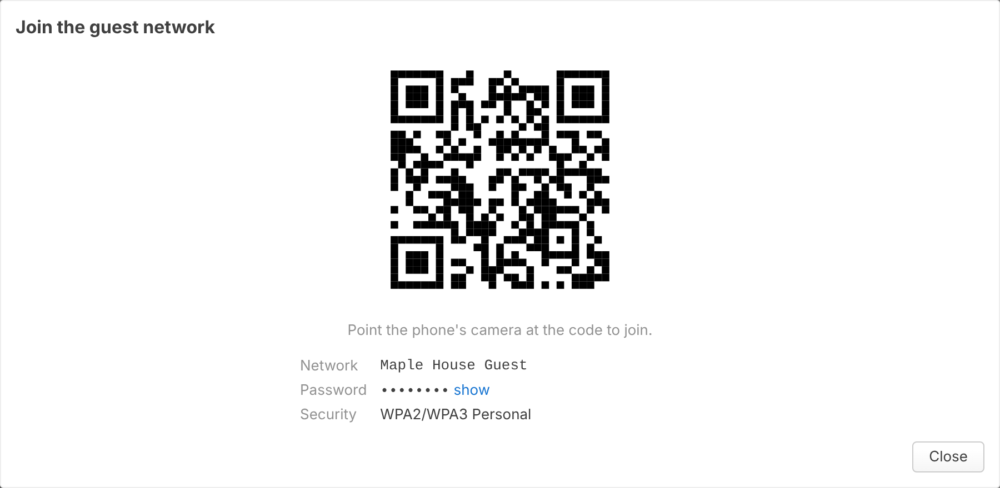
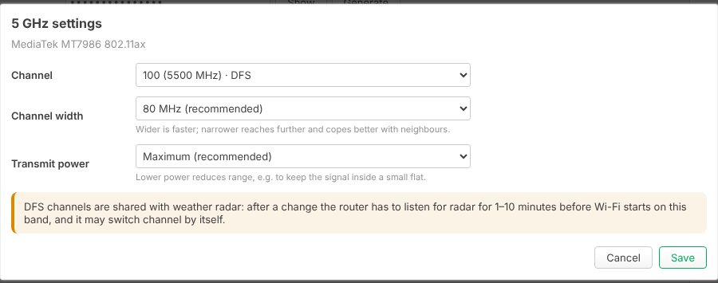
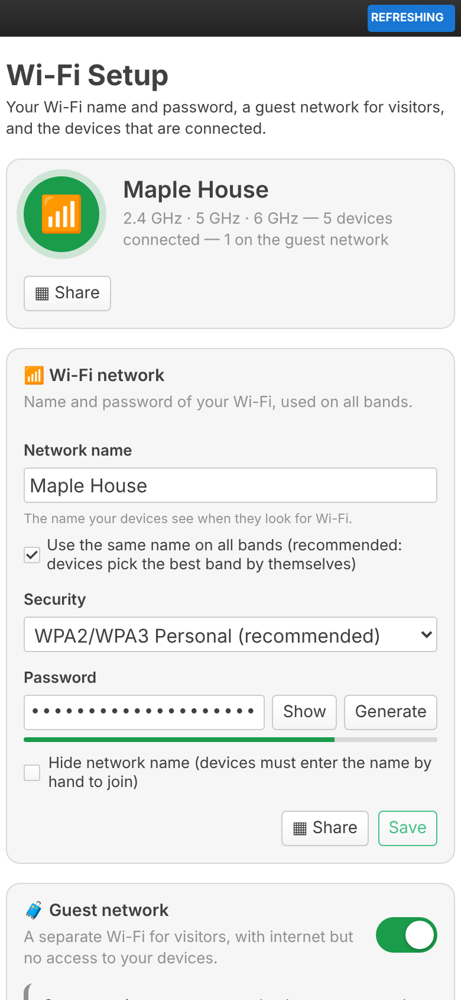

# Tether: simple Wi-Fi setup for OpenWrt (luci-app-tether)

A clean, consumer-router style Wi-Fi page for OpenWrt's LuCI web interface. Everything most home routers offer, on one page:

- **Network name and password** for all bands at once (or a different name per band), with a password generator and strength meter
- **Security**: WPA2/WPA3 (recommended), WPA3, WPA2, WPA/WPA2, Enhanced Open (OWE) or Open; 6 GHz automatically uses WPA3 / OWE, as the standard requires
- **Hidden network** option
- **Guest network** in one click: its own name and password, its own address range, internet only (no access to your devices or the router), guests kept apart from each other, pick the bands it's on
- **Bands** (2.4 / 5 / 6 GHz): on/off, channel (with DFS hints), channel width and transmit power, plus the country setting
- **Connected devices**: name, IP, band, signal, speed and connection time; **disconnect** or **block** a device (and unblock it later)
- **Share** a network with a **QR code** that phones can scan to join
- **Schedule**: turn Wi-Fi off at night or during set hours, on chosen days
- Works on desktop and phone, light and dark theme

Built and tested for **OpenWrt 25.12** (apk package manager).

<p align="center">
  
</p>

| Share with a QR code | Band settings | On a phone |
|---|---|---|
|  |  |  |

<sub>Screenshots show sample data; colours and fonts follow your LuCI theme.</sub>

## Install on your router

1. Get the package
   - From the [Releases](../../releases) page (a release is published on every merge into `main`), or
   - From the **Actions** tab → latest *Build package* run → artifact `luci-app-tether-openwrt-25.12.2` (it's a zip with the `.apk` inside).
2. Copy it to the router (`-O` is needed because OpenWrt has no SFTP server by default):
   ```sh
   scp -O luci-app-tether-*.apk root@192.168.1.1:/tmp/
   ```
3. Install it on the router. The package is built by CI, not signed by OpenWrt, so allow it explicitly:
   ```sh
   ssh root@192.168.1.1
   apk update
   apk add --allow-untrusted /tmp/luci-app-tether-*.apk
   ```
   `apk update` lets apk pull the dependencies it doesn't find on the router (`qrencode`, `rpcd-mod-iwinfo`, the ucode modules, ...) from the official feeds, so the router needs internet access for the install.
4. **Log out of LuCI and log back in**, then open **Network → Wi-Fi Setup**. LuCI decides which menu entries you may see when you log in, so an already open session won't show the new entry.

> Tip: do the first setup from a computer connected by **cable**. Changing the Wi-Fi name or password disconnects every Wi-Fi device, including the one you're using; the page waits and continues by itself once you reconnect, but a cable makes it painless.

### Installing from LuCI (signed packages)

OpenWrt only trusts packages signed with a key in `/etc/apk/keys`. Unsigned self-built packages fail with `UNTRUSTED signature` unless `--allow-untrusted` is passed, which LuCI's **Upload Package…** dialog cannot do. CI therefore signs the package with your own key:

**Once, on GitHub:** create a signing key on your computer and store it as a repository secret.

```sh
openssl ecparam -name prime256v1 -genkey -noout -out apk-signing-key.pem
```

GitHub → repository → *Settings → Secrets and variables → Actions → New repository secret*: name `APK_SIGNING_KEY`, value: the contents of `apk-signing-key.pem`. Keep the file somewhere safe and private. (You can reuse the key of your other apps.) Every build after that is signed, and the artifact / release additionally contains `tether.pem` (the public key) and `packages.adb` (a signed package index).

**Releases:** every merge into `main` publishes a GitHub release `v<PKG_VERSION>-r<N>` (e.g. `v1.0.0-r12`), where `N` is the number of commits on `main`, set automatically by CI; only bump `PKG_VERSION` in the Makefile for a new version. The latest release's files are always at:

```
https://github.com/willhuang85/luci-tether/releases/latest/download/<file>
```

**Once, on the router:** trust the public key.

```sh
wget -O /etc/apk/keys/tether.pem \
  https://github.com/willhuang85/luci-tether/releases/latest/download/tether.pem
```

Then install from **System → Software → Upload Package…** with no extra flags. Or add the release as a package feed, so the app shows up and updates in *System → Software* like any other package:

```sh
echo "https://github.com/willhuang85/luci-tether/releases/latest/download/packages.adb" >> /etc/apk/repositories.d/customfeeds.list
```

> While the repository is private, GitHub only serves release files to logged-in users, so the `wget` and feed commands don't work. Download `tether.pem` and the `.apk` from the release page in your browser, `scp -O tether.pem root@192.168.1.1:/etc/apk/keys/` and use *Upload Package…*.

### Troubleshooting

- **Installed but no menu entry** – log out of LuCI and back in (and reload the page with Ctrl+F5). Still nothing? Check `apk info -e luci-app-tether`, run `/etc/init.d/rpcd restart` and verify `ubus list luci.tether` prints the object.
- **WPA3 options are greyed out** – the installed `wpad` variant has no SAE support. OpenWrt 25.12 ships `wpad-basic-mbedtls`, which has it; if you replaced it with a "mini" variant, install `wpad-basic-mbedtls` (or `wpad-mbedtls`) again.
- **A band stays "Starting…"** – on DFS channels (5 GHz 52–144) the router must listen for radar for 1–10 minutes first. Also check the **Country**: channels and power not allowed in the selected country don't start. `logread -e hostapd` shows the details.
- **`UNTRUSTED signature`** – see *Installing from LuCI* above, or use `apk add --allow-untrusted`.

To uninstall: `apk del luci-app-tether`. Your Wi-Fi settings stay as they are; the schedule is removed so Wi-Fi is never left switched off.

## Using it

1. Under **Wi-Fi network**, pick a name and a password (or press **Generate**) and **Save**.
2. Under **Bands**, make sure the bands you want are switched on. A fresh OpenWrt install has Wi-Fi off; the page asks before broadcasting a network that has no password.
3. Optional: switch on the **Guest network**, give it a name and password and press **Turn on guest network**.
4. Use **Share** to show a QR code that phones and tablets can scan to join.

Settings are applied right away. Devices on Wi-Fi drop off for a few seconds while the radios restart; if you changed the name or password, reconnect with the new one.

### Guest network

The guest network gets its own bridge `br-guestwifi`, interface `guestwifi` with the first free `192.168.x.1/24` (usually `192.168.3.1`), a DHCP pool, and a firewall zone `guestwifi` that may only forward to `wan` and may only use DHCP and DNS on the router. Guests can't reach your LAN, the router's web interface or SSH. With *Keep guests apart* (on by default) guest devices can't see each other either. The guest network is IPv4 only.

Turning the guest network off disables its access points but keeps its settings, so turning it on again restores it.

### Blocking devices

A blocked device is disconnected and put on a deny list (`macfilter deny`) on all main and guest access points, so it can't join any of your Wi-Fi networks. Devices that use a random ("private") MAC address per network get a new address when they forget the network, so blocking is a convenience, not a security boundary: for that, change the password.

If you configured an *allow list* on an access point yourself (under *Network → Wireless*), this app leaves that access point's list alone.

### Schedule

Wi-Fi switches off at the *off* time on the selected days and back on at the *on* time (an overnight period such as 23:00–07:00 ends the next morning). It uses the router's clock and time zone (*System → System*); wired devices are not affected. If the router boots during an off period, Wi-Fi is switched off again shortly after boot. Saving any Wi-Fi setting during an off period turns Wi-Fi back on until the next scheduled off time.

## How it works

The page talks to an rpcd plugin (ubus object `luci.tether`) that edits the normal OpenWrt configuration, so everything stays visible and editable under *Network → Wireless* too.

| What | Where |
|---|---|
| Main network | the first access point on the `lan` network of each radio (e.g. `wireless.default_radio0`); radios without one get `wireless.tether_main_<radio>` |
| Guest network | `wireless.tether_guest_<radio>`, `network.guestwifi`, `network.tether_guest_dev`, `dhcp.guestwifi`, `firewall.tether_guest_*` |
| Bands | `wireless.<radio>`: `disabled`, `channel`, `htmode`, `txpower`, `country` |
| Blocked devices | `tether.@block[]`, applied as `macfilter`/`maclist` on the access points above |
| Schedule | `tether.schedule`, applied as lines tagged `# tether-schedule` in `/etc/crontabs/root` |

Changes are committed immediately and applied one second after the router has answered (`ubus call network reload`, plus firewall/dnsmasq when the guest network is first created), so the browser gets its reply before Wi-Fi restarts. The page then waits for the router to answer again.

The network names in `/etc/config/tether` (`lan_network`, `lan_zone`, `wan_zone`) can be changed if yours differ from `lan`/`wan`.

Code layout:

```
luci-app-tether/
├── Makefile                                        OpenWrt package definition
├── htdocs/luci-static/resources/view/tether/
│   └── overview.js                                 the web UI
└── root/
    ├── etc/config/tether                           settings, schedule, blocked devices
    ├── etc/init.d/tether                           applies the schedule at boot
    └── usr/
        ├── libexec/tether-schedule                 Wi-Fi off/on, writes the cron entries
        └── share/
            ├── luci/menu.d/luci-app-tether.json    menu entry (Network → Wi-Fi Setup)
            ├── rpcd/acl.d/luci-app-tether.json     permissions
            ├── rpcd/ucode/luci.tether              backend (ubus object luci.tether)
            └── ucode/tether/schedule.uc            schedule helpers
```

## Building

The GitHub Actions workflow (`.github/workflows/build.yml`) runs on every push:

1. **test** – builds ucode, rpcd and friends at the exact revisions of the OpenWrt release, loads the backend into a real rpcd next to fake `iwinfo` / `network.wireless` / `hostapd` objects and walks through every feature, runs the unit tests, syntax-checks JS/JSON.
2. **build** – downloads the official OpenWrt 25.12.2 SDK, builds the package and uploads the `.apk` as an artifact. The package is architecture independent, so one build works on every router.
3. **release** – on every push to `main` (and on pushed `v*` tags), publishes the `.apk` (plus, when signed, `packages.adb` and the public key) as a GitHub release `v<PKG_VERSION>-r<commit count>`.

Build for another OpenWrt release via *Actions → Build package → Run workflow* and enter the version.

Build locally with an OpenWrt SDK:

```sh
ln -s "$PWD/luci-app-tether" /path/to/openwrt-sdk/package/
cd /path/to/openwrt-sdk
make defconfig && make package/luci-app-tether/compile V=s
```

Run the tests (needs a [ucode](https://github.com/jow-/ucode) build, ideally the revision your OpenWrt release ships):

```sh
UCODE_DIR=/path/to/ucode/build ./tests/run.sh
```

`tests/integration.sh` builds libubox, ubus, uci, ucode and rpcd at the revisions used by the OpenWrt release and drives the real plugin over ubus. It installs into `/usr` and `/etc/config`, so only run it on a throwaway machine or container (CI does this on every push).

## License

Apache-2.0
