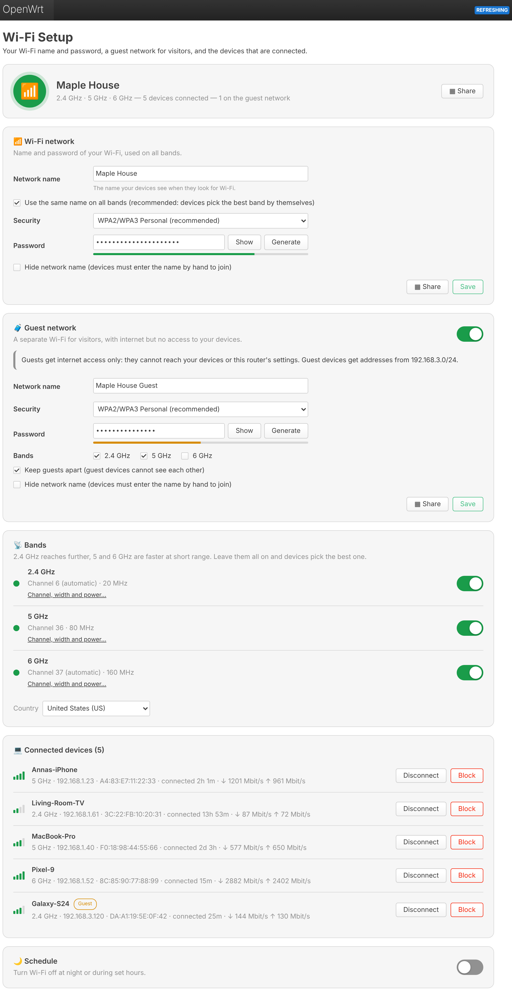

# luci-apps

Simple, consumer-router style apps for OpenWrt's LuCI web interface. Built and tested for **OpenWrt 25.12** (apk package manager); install any of them.

| App | Menu | What it does |
|---|---|---|
| [**Wi-Fi Setup**](luci-app-wifisetup/README.md) (`luci-app-wifisetup`) | Services → Wi-Fi Setup | Network name, password and security for all bands, guest network, channels / width / power, connected devices with block, QR code sharing, Wi-Fi schedule |
| [**Phone Tethering**](luci-app-tether/README.md) (`luci-app-tether`) | Services → Phone Tethering | When the main internet is down, use an iPhone's or Android phone's mobile data over USB or its Wi-Fi hotspot; switch back when the main connection works again |
| [**WireGuard + Passwall**](luci-app-wireguard-passwall/README.md) (`luci-app-wireguard-passwall`) | Services → WireGuard + Passwall | WireGuard VPN client: import your provider's `.conf`, one-click connect, kill switch, and modes to carry the VPN through a Passwall proxy node |

| Wi-Fi Setup | Phone Tethering | WireGuard + Passwall |
|---|---|---|
|  |  |  |

<sub>Screenshots show sample data; colours and fonts follow your LuCI theme. Tested with the default Bootstrap theme and [Argon](https://github.com/jerrykuku/luci-theme-argon), light and dark.</sub>

## Install on your router

1. Get the packages
   - From the [Releases](../../releases) page (a release with all packages is published on every merge into `main`), or
   - From the **Actions** tab → latest *Build packages* run → artifact `luci-apps-openwrt-25.12.2` (a zip with the `.apk` files inside).
2. Copy the ones you want to the router (`-O` is needed because OpenWrt has no SFTP server by default):
   ```sh
   scp -O luci-app-*.apk root@192.168.1.1:/tmp/
   ```
3. Install them on the router. The packages are built by CI, not signed by OpenWrt, so allow them explicitly:
   ```sh
   ssh root@192.168.1.1
   apk update
   apk add --allow-untrusted /tmp/luci-app-*.apk
   ```
   `apk update` lets apk pull the dependencies it doesn't find on the router (`qrencode`, `usbmuxd`, `wireguard-tools`, the ucode modules, ...) from the official feeds, so the router needs internet access for the install. Install the tethering app **before** you need it.
4. **Reload the LuCI page** (Ctrl+F5), then open the new pages under **Services**. Installing doesn't log you out.

### Installing from LuCI (signed packages)

OpenWrt only trusts packages signed with a key in `/etc/apk/keys`. Unsigned self-built packages fail with `UNTRUSTED signature` unless `--allow-untrusted` is passed, which LuCI's **Upload Package…** dialog cannot do. CI therefore signs the packages with your own key:

**Once, on GitHub:** create a signing key on your computer and store it as a repository secret.

```sh
openssl ecparam -name prime256v1 -genkey -noout -out apk-signing-key.pem
```

GitHub → repository → *Settings → Secrets and variables → Actions → New repository secret*: name `APK_SIGNING_KEY`, value: the contents of `apk-signing-key.pem`. Keep the file somewhere safe and private (you can reuse the key of your other apps). Every build after that is signed, and the artifact / release additionally contains `luci-apps.pem` (the public key) and `packages.adb` (a signed package index).

**Releases:** every merge into `main` publishes a GitHub release `r<N>` (e.g. `r12`), where `N` is the number of commits on `main` and also the package release (`luci-app-tether-1.0.0-r12.apk`). Bump `PKG_VERSION` in an app's Makefile for a new version of that app. The latest release's files are always at:

```
https://github.com/willhuang85/luci-apps/releases/latest/download/<file>
```

**Once, on the router:** trust the public key.

```sh
wget -O /etc/apk/keys/luci-apps.pem \
  https://github.com/willhuang85/luci-apps/releases/latest/download/luci-apps.pem
```

Then install from **System → Software → Upload Package…** with no extra flags. Or add the release as a package feed, so the apps show up and update in *System → Software* like any other package:

```sh
echo "https://github.com/willhuang85/luci-apps/releases/latest/download/packages.adb" >> /etc/apk/repositories.d/customfeeds.list
```


### Troubleshooting

- **Installed but no menu entry** – reload the page with Ctrl+F5. Still nothing? Check `apk info -e luci-app-wifisetup` (or the app you installed), run `/etc/init.d/rpcd reload` and verify `ubus list 'luci.*'` lists `luci.wifisetup`, `luci.tether` or `luci.wgpasswall`.
- **`UNTRUSTED signature`** – see *Installing from LuCI* above, or use `apk add --allow-untrusted`.
- **`wget ... Failed to send request: Operation not permitted`** during `apk update` – the router itself cannot reach the package mirror; a firewall rule is dropping the router's own outgoing traffic (not related to these apps). Check with:
  ```sh
  ping -c 3 1.1.1.1                 # basic connectivity
  nslookup downloads.openwrt.org    # DNS
  ip rule                           # look for "prohibit"/"blackhole"
  nft list ruleset | grep -inE 'drop|reject' | head -30
  ```
  If a proxy app such as Passwall runs with "Localhost proxy", stop it briefly (`/etc/init.d/passwall stop`), run `apk update`, install, then start it again.
  If Passwall is already off but `ping 1.1.1.1` works while `apk update` fails, Passwall's rules for the router's own traffic were left behind (its table is still listed by `nft list tables`): `nft delete table inet passwall` removes them, and Passwall recreates the table on its next start. These apps run their firewall reloads and Passwall restarts one at a time to avoid this; toggling Passwall from its own page at the same moment can still cause it.
- App specific: see the [Wi-Fi Setup](luci-app-wifisetup/README.md#troubleshooting) and [Phone Tethering](luci-app-tether/README.md#troubleshooting) READMEs.

## Building

The GitHub Actions workflow (`.github/workflows/build.yml`) runs on every push:

1. **test** – builds ucode, rpcd and friends at the exact revisions of the OpenWrt release (`tests/lib/build-stack.sh`), loads the backends into a real rpcd next to fake `iwinfo` (loaded into rpcd, as on a router) / `network.wireless` / `network.interface` / `hostapd` objects (and a fake `/sys` with a plugged-in iPhone) and walks through every feature, runs the unit tests, tests the WireGuard relay end to end against a stub SOCKS5 proxy, syntax-checks JS/JSON/shell.
2. **build** – downloads the official OpenWrt 25.12.2 SDK, builds all packages and uploads the `.apk` files as an artifact. The packages are architecture independent, so one build works on every router.
3. **release** – on every push to `main` (and on pushed `v*` tags), publishes the `.apk` files (plus, when signed, `packages.adb` and the public key) as a GitHub release.

Build for another OpenWrt release via *Actions → Build packages → Run workflow* and enter the version.

Build locally with an OpenWrt SDK:

```sh
ln -s "$PWD"/luci-app-* /path/to/openwrt-sdk/package/
cd /path/to/openwrt-sdk
make defconfig && make package/luci-app-wifisetup/compile V=s    # or any other app
```

Run the tests (needs a [ucode](https://github.com/jow-/ucode) build, ideally the revision your OpenWrt release ships):

```sh
UCODE_DIR=/path/to/ucode/build ./tests/run.sh
```

`tests/integration.sh` (Wi-Fi Setup and Phone Tethering) and `tests/wgpasswall/integration.sh` build libubox, ubus, uci, ucode and rpcd at the revisions used by the OpenWrt release and drive the real plugins over ubus; `tests/wgpasswall/relay_test.sh` tests the WireGuard → SOCKS5 relay. It installs into `/usr` and `/etc/config`, so only run it on a throwaway machine or container (CI does this on every push).

## License

Apache-2.0
