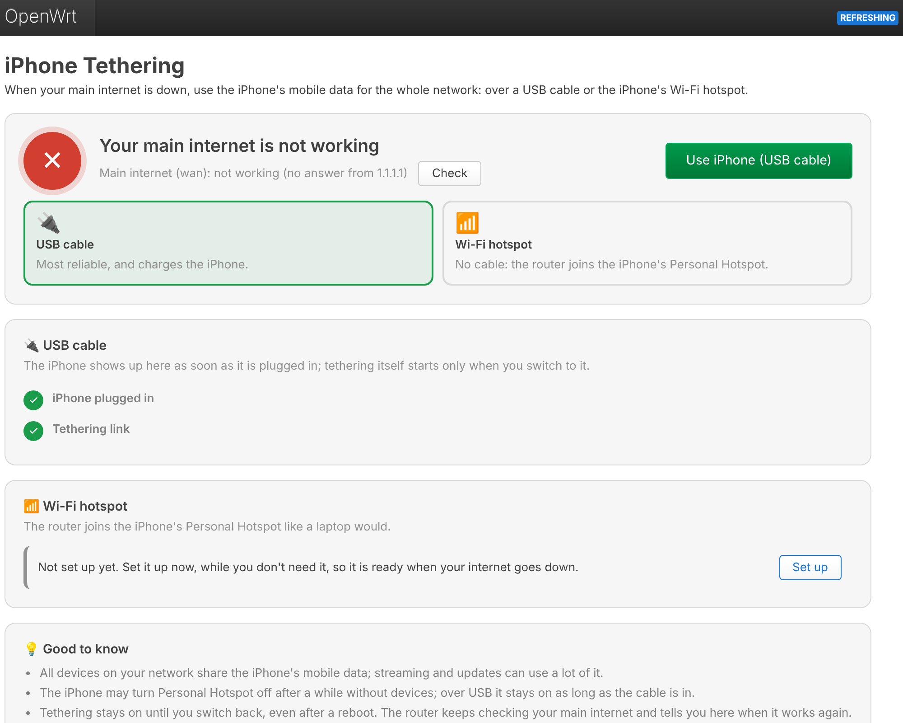
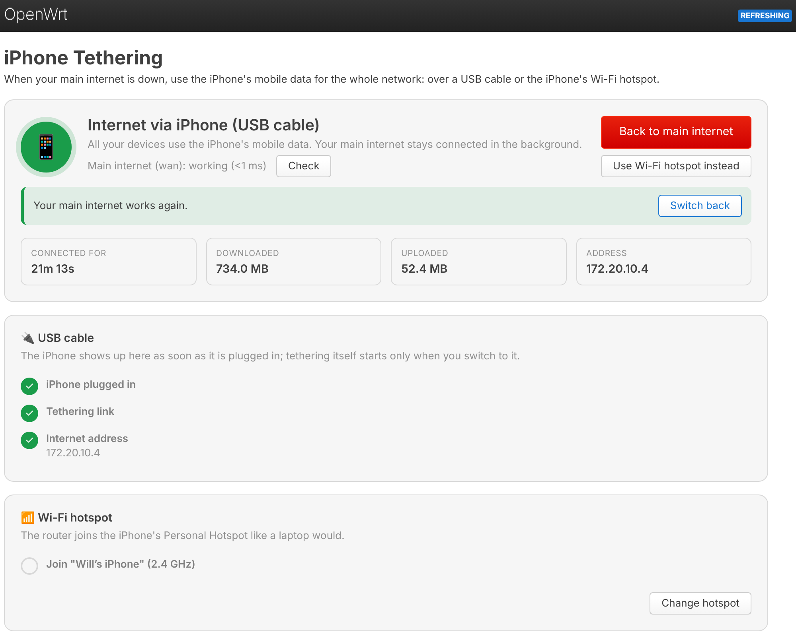
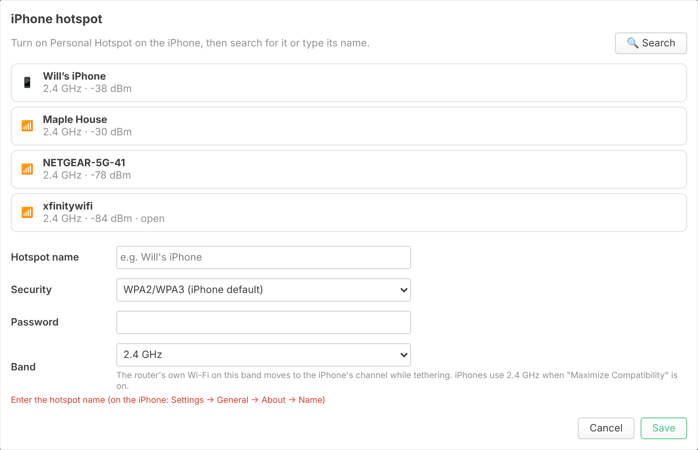
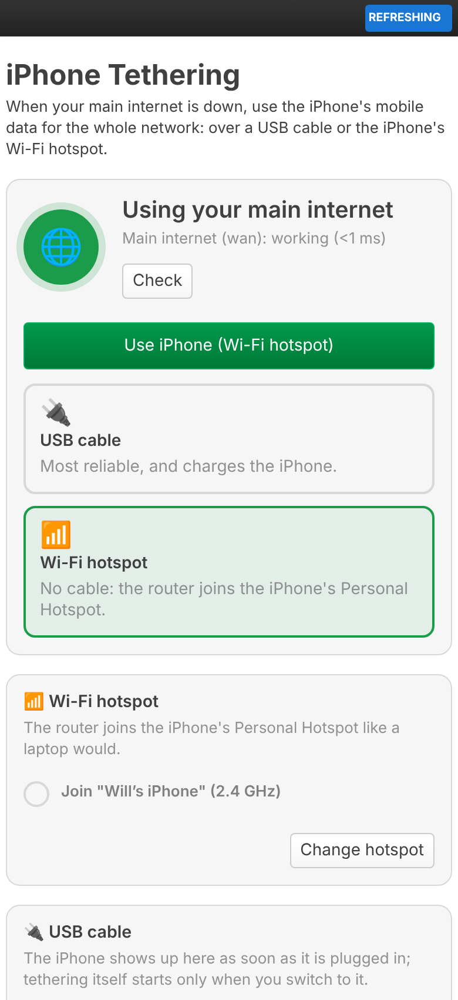

# Phone Tethering (luci-app-tether)

When your main internet is down, switch the whole network to your phone's mobile data with one click, and back again when the main connection works. Works with iPhones and Android phones (e.g. Pixel, Galaxy).

- **USB cable** – plug the phone into the router's USB port (most reliable, and it charges the phone): iPhone or Android
- **Wi-Fi hotspot** – the router joins the phone's hotspot, no cable needed; a search lists nearby hotspots, phones first. Works with any phone
- **Main internet check** – one click tests whether your main connection works; while tethering, the page keeps checking and tells you when it's back
- **Live status**: step-by-step checklist (plugged in, tethering link, internet address), time connected, data downloaded / uploaded
- Switch between USB and Wi-Fi while tethering, and back to the main internet with one click

Menu: **Services → Phone Tethering**. Installation: see the [main README](../README.md). The package pulls in the USB tethering drivers: `kmod-usb-net-ipheth` and `usbmuxd` for iPhones (`usbmuxd` handles the "Trust this computer?" pairing), `kmod-usb-net-cdc-ncm` for recent Android phones such as Pixels, and `kmod-usb-net-rndis` for older ones.

<p align="center">
  
</p>

| Tethering, main internet back | Finding the hotspot | On a phone |
|---|---|---|
|  |  |  |

<sub>Screenshots show sample data; colours and fonts follow your LuCI theme.</sub>

## Set it up before you need it

Do this once while your internet works, so everything is ready when it isn't:

- **Install the package** – it needs internet to download its dependencies.
- **USB, iPhone**: plug in the iPhone, unlock it and tap **Trust** when asked. The pairing is stored on the router (`/etc/lockdown`), so you only do this once. The *USB cable* card shows a tick for "iPhone plugged in" and, with Personal Hotspot on, "Tethering link".
- **USB, Android**: plug in the phone; the card shows e.g. "Pixel 9 plugged in". Turn on *Settings → Network & internet → Hotspot & tethering → USB tethering* and "Tethering link" gets its tick. Android switches USB tethering off when the cable is unplugged, so turn it on again each time.
- **Wi-Fi**: under *Wi-Fi hotspot* press **Set up**, pick your phone from the search and enter the hotspot password (iPhone: *Settings → Personal Hotspot*, Android: *Settings → Network & internet → Hotspot & tethering → Wi-Fi hotspot*).

## When your internet goes down

1. Open **Services → Phone Tethering** (connect to the router by cable or its Wi-Fi as usual). The page checks your main internet and says if it isn't working.
2. Pick **USB cable** or **Wi-Fi hotspot** and press **Use phone**.
3. On the phone, turn on the hotspot or USB tethering as above (iPhone over USB: plug it in, unlock it, Personal Hotspot on). The checklist turns green and the page shows e.g. "Internet via Pixel 9".
4. When the page says **Your main internet works again**, press **Switch back** (or **Back to main internet** at any time).

Tethering stays on until you switch back, also across reboots.

### Good to know

- All devices on your network share the phone's mobile data. Streaming, backups and updates can use a lot; check the *Downloaded* counter.
- Tethering gives the router a private address (iPhone: `172.20.10.x`) and the app sets it up for **IPv4 only**. The main connection's IPv6 (`wan6`) is paused while tethering so devices don't wait for IPv6 that can't work, and resumed afterwards.
- **Wi-Fi method**: a radio can only be on one channel, so the router's own Wi-Fi on the band you pick moves to the phone's channel while tethering (devices reconnect automatically). iPhones use 2.4 GHz when *Maximize Compatibility* is on in the hotspot settings, otherwise 5 GHz; Android lets you pick the band in its hotspot settings. Keep the hotspot screen open until the router has joined; phones turn the hotspot off after a while without devices.
- **USB method**: the phone charges while plugged in. If the link doesn't come up, unplug and replug, unlock the phone and check that Personal Hotspot (iPhone) or USB tethering (Android) is on.

## How it works

The page talks to an rpcd plugin (ubus object `luci.tether`) that edits the normal OpenWrt configuration:

| What | Where |
|---|---|
| USB tethering | interface `network.tether_usb` (DHCP) on the phone's network device: `ipheth` driver for iPhones, `cdc_ncm` or `rndis_host` for Android. Its name (`eth1`, `usb0`, …) depends on the hardware; `/etc/hotplug.d/net/30-tether` keeps it up to date when the phone is plugged in. Android phones are recognised by their maker's USB vendor ID before USB tethering is on |
| Wi-Fi tethering | client section `wireless.tether_sta` (mode `sta`) on interface `network.tether_wifi` (DHCP) |
| Firewall | both interfaces are added to the `wan` zone, so LAN traffic is masqueraded through them like through the normal WAN |
| On / off | `tether.settings.active` and `.method` |

Switching on brings up the chosen interface and gives the main internet a lower priority instead of switching it off: every interface of the `wan` zone gets **+1000 on its route metric**, so the phone's default route (metric 10) wins while the main connection stays up for the "works again" check. IPv6-only interfaces (`dhcpv6`, `6in4`, …) are paused. The previous values are saved in `tether.settings.saved` and put back when you switch back. Changes are applied a second after the router has answered, so the browser gets its reply first.

The check pings `1.1.1.1` through the main interface's device (`ping -I`), so it tests the main connection even while the default route goes to the phone. Change the target with `uci set tether.settings.check_host=…`, the zone with `tether.settings.wan_zone`.

Uninstalling (`apk del luci-app-tether`, or `opkg remove` on OpenWrt 24.10) switches back to the main internet first.

Code layout:

```
luci-app-tether/
├── Makefile                                        OpenWrt package definition
├── htdocs/luci-static/resources/view/tether/
│   └── overview.js                                 the web UI
└── root/
    ├── etc/config/tether                           on/off, method, saved main-internet settings
    ├── etc/hotplug.d/net/30-tether                 follows the phone's USB network device
    └── usr/share/
        ├── luci/menu.d/luci-app-tether.json        menu entry (Services → Phone Tethering)
        ├── rpcd/acl.d/luci-app-tether.json         permissions
        └── rpcd/ucode/luci.tether                  backend (ubus object luci.tether)
```

## Troubleshooting

- **USB: "plugged in" stays empty** – try another cable (some only charge) or port. `logread -e usbmuxd` (iPhone) and `ls /sys/bus/usb/drivers/ipheth /sys/bus/usb/drivers/cdc_ncm /sys/bus/usb/drivers/rndis_host` show whether the phone was recognised. Android phones from makers the app doesn't know only show up once USB tethering is on.
- **USB: plugged in but no tethering link** – Android: turn on USB tethering (after every plug-in). iPhone: unlock it, tap *Trust*, turn Personal Hotspot on. If you once tapped *Don't Trust*: on the iPhone, *Settings → General → Transfer or Reset iPhone → Reset → Reset Location & Privacy*, then plug in again.
- **Wi-Fi: never joins** – check the password, keep the Personal Hotspot screen open, and make sure the band you picked matches the hotspot (search again to see its band). `logread -e wpa_supplicant` shows why it failed.
- **Tethering on, but no internet** – the phone needs mobile data and a plan that allows tethering / hotspot.
