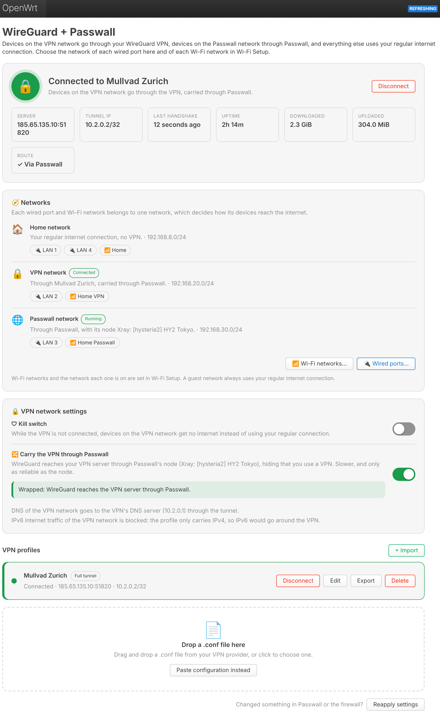
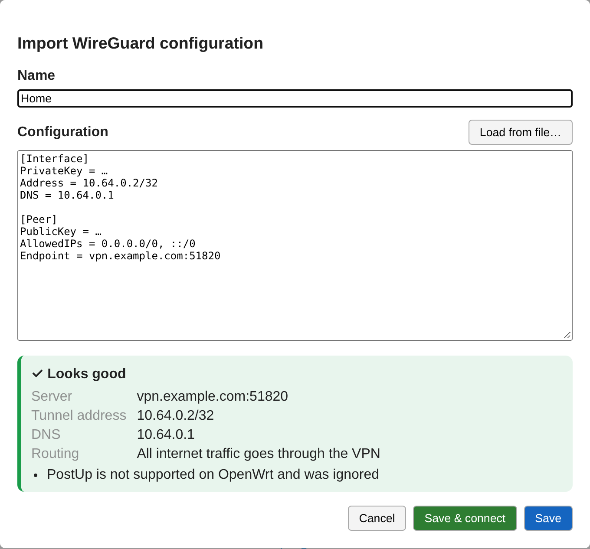
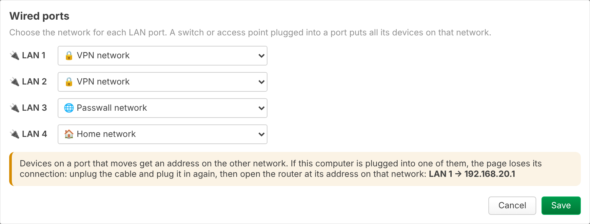
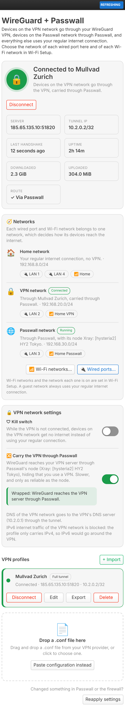

# WireGuard + Passwall (luci-app-wireguard-passwall)

A simple WireGuard VPN **client** for OpenWrt's LuCI web interface, built around **networks**: plug a device into a port or join a Wi-Fi network, and that decides whether it goes through the VPN, through [Passwall](https://github.com/Openwrt-Passwall/openwrt-passwall), or out directly.

- **Networks**: a **VPN network** (its devices go through the VPN) and, with Passwall installed, a **Passwall network** (through Passwall), next to your **home network** (regular internet connection)
- **Wired ports** are put on a network here; **Wi-Fi networks** in [Wi-Fi Setup](../luci-app-wifisetup/README.md), which can add more Wi-Fi names, e.g. "Home VPN"
- **Import** the `.conf` file from your VPN provider (drag & drop, file picker or paste) with a live check of the file before saving
- **One-click connect / disconnect**, only one profile is active at a time, with live status: handshake, uptime, traffic, server and tunnel address
- **Kill switch**: devices on the VPN network get no internet while the VPN is not connected
- **Carry the VPN through Passwall**: WireGuard reaches your VPN server through Passwall's node
- Edit, export and delete profiles; works on desktop and phone

Menu: **Services → WireGuard + Passwall**. Installation: see the [main README](../README.md).

<p align="center">
  
</p>

| Import with a live check | Wired ports | On a phone |
|---|---|---|
|  |  |  |

<sub>Screenshots show sample data; colours and fonts follow your LuCI theme.</sub>

## Using it

1. Click the drop zone or **+ Import**, pick your `.conf` file, give it a name.
2. Check the preview ("Looks good", server, routing) and press **Save & connect**.
3. Put devices on the VPN network: **Wired ports…** for a LAN port, or in Wi-Fi Setup add a Wi-Fi network (e.g. "Home VPN") on the VPN network.
4. Optional: turn on the **Kill switch**, or **Carry the VPN through Passwall**.

The status card turns green once the server answered with a handshake. A profile that is connected stays connected after a reboot.

## The networks

| Network | Its devices go | Created by |
|---|---|---|
| 🏠 **Home network** (`lan`) | out directly, your regular internet connection | OpenWrt |
| 🔒 **VPN network** (`wgvpn`, bridge `br-wgvpn`) | through the VPN; while no VPN is connected out directly, or nowhere with the kill switch on | this app |
| 🌐 **Passwall network** (`wgproxy`, bridge `br-wgproxy`) | through Passwall, with the node selected in Passwall | this app, when Passwall is installed |
| Guest network (e.g. from Wi-Fi Setup) | always out directly, past both the VPN and Passwall | Wi-Fi Setup |

The app creates the VPN and Passwall networks the first time it runs: each gets its own bridge, a free `192.168.x.0/24` range (from `192.168.20.0` and `192.168.30.0` upwards), a DHCP pool and a firewall zone that, like the LAN, may reach the router (DHCP, DNS, LuCI) and the home network. Devices on different networks don't discover each other (AirPlay, printers, ...), but can reach each other by address.

- **Wired ports**: **Wired ports…** moves the LAN ports between the home, VPN and Passwall bridges. A switch or access point plugged into a port puts all its devices on that network. If your computer is on a port you move, it gets an address on the other network: unplug and plug the cable back in, then open the router at that network's address (the dialog shows it).
- **Wi-Fi networks**: in Wi-Fi Setup, **More Wi-Fi networks → Add Wi-Fi network**, then pick the network. Your main Wi-Fi stays on the home network.
- Everything matches by network, so the rules of the networks never overlap or depend on each other's order.

### What the kill switch does

When on, a firewall rule rejects all traffic from the VPN network's zone to the `wan` zone. Traffic into the VPN tunnel is still allowed, so:

- VPN connected → devices on the VPN network work through the tunnel.
- VPN drops or is disconnected → they have **no internet** until a VPN connects again. Nothing leaks over your normal connection.

The home network, the Passwall network and the router itself are not affected (the router needs its connection to reach the VPN server); access to LuCI/SSH works from every network. The WAN zone name can be changed in `/etc/config/wgpasswall` if yours is not `wan`.

### DNS

WireGuard itself knows nothing about DNS: the `DNS =` line of a `.conf` is used by WireGuard apps on phones and computers to set the device's DNS. On a router it would only become one more upstream server of the router's resolver, next to the one from the internet connection, which usually answers first, so devices would browse from the VPN but resolve from home.

So while a profile is connected, the DNS queries of the VPN network go to the VPN's DNS server from the `.conf` through the tunnel, whether they ask the router or any other server on port 53. Their IPv6 queries to the router are refused when the VPN has no IPv6 DNS server, so they fall back to IPv4. The VPN's DNS server is not used by the router's own resolver, which keeps using the internet connection's DNS (it has to look up the VPN server before the tunnel is up). The other networks keep using the router's DNS.

Where each network's DNS goes:

| Network | DNS |
|---|---|
| Home network, guest network | the router's resolver (dnsmasq), which asks the internet connection's DNS server directly; Passwall and the VPN don't change it |
| VPN network, profile connected | every query on port 53 → the VPN's DNS server (`DNS =` of the `.conf`), through the tunnel (and through Passwall when the VPN is carried through it) |
| VPN network, no profile connected | the router's resolver, as on the home network; **with the kill switch on, refused** (devices have no internet then anyway, and the names they look up would otherwise reach your ISP's DNS) |
| Passwall network | every query on port 53 → Passwall's own DNS (its dnsmasq instance with ChinaDNS-NG: the "direct" server for direct domains, the "remote" server through the node for the others), whether or not a VPN is connected |
| The router itself | through Passwall's DNS while its Localhost Proxy is on, otherwise the internet connection's DNS server |

- Devices on the VPN network cannot look up the router's local names (`something.lan`); mDNS names (`something.local`) still work.
- Encrypted DNS done by a browser or the OS itself (DoH) is not touched; it goes through the VPN like the rest of their traffic.
- Without a `DNS =` line nothing is redirected and the devices use the router's DNS, outside the VPN.

### Good to know

- **IPv6**: the VPN and Passwall networks get IPv4 addresses only. While a profile that sends all IPv4 through the VPN (`0.0.0.0/0`) but has no `::/0` is connected, IPv6 internet traffic from the VPN network is also refused (firewall rule `wgpasswall_no_ipv6`), in case you add IPv6 to it yourself.
- **What does not use the VPN** for devices on the VPN network: addresses reachable without the internet (your other networks, and the network on the router's WAN side, e.g. the home router it is plugged into) and Tailscale addresses (`100.x`).
- **The router's own traffic** (package updates, NTP, ...): through Passwall while Passwall runs with its *Localhost Proxy* on (your choice in Passwall, e.g. for package updates where the package servers are blocked); otherwise through the VPN while a profile is connected directly, otherwise out directly. The page shows which under *Networks → This router*. WireGuard marks its own packets `0xcaff`, ending in `ff` like Xray's, so Passwall's Localhost Proxy leaves them alone and the tunnel keeps working.
- **PersistentKeepalive**: on a router behind NAT, and with the VPN carried through Passwall, an idle tunnel can go quiet until NAT or the proxy forgets it. When a `.conf` has none, the import / edit dialog offers to add `PersistentKeepalive = 15` (inside the ~30 s shortest UDP timeouts even if one keepalive is lost); it costs well under 1 MB a day.
- `PreUp`/`PostUp`/`Table` lines from wg-quick have no meaning on OpenWrt and are ignored (you'll see a note when importing).
- **Upgrading from a version with modes** ("VPN", "VPN through Passwall", "Passwall only", "Off", "only chosen devices"): those are gone. "VPN through Passwall" becomes **Carry the VPN through Passwall**; everything else comes from the networks now, so after upgrading put the ports and Wi-Fi networks that should use the VPN (or Passwall) on its network. Until then your devices stay on the home network and use your regular connection, and the kill switch only covers the (empty) VPN network.

## Using it together with Passwall / Xray

The app runs next to transparent proxies (Passwall, Passwall 2, HomeProxy, OpenClash) without them getting in each other's way: the VPN routes live in their own routing table (`51820`) and only *unmarked* traffic uses it, so a proxy core's own connections (Xray and sing-box mark them with `255`) never loop into the tunnel.

### Passwall (not Passwall 2)

With Passwall installed, the app adds the Passwall network and the **Carry the VPN through Passwall** switch, and runs Passwall only while something needs it: devices on the Passwall network (a wired port or an enabled Wi-Fi network), or a connected VPN carried through it. You still use Passwall itself to pick, add or subscribe to nodes, read its logs and tune its own rules (direct/proxy/block lists, DNS); the page shows the node Passwall uses and warns when none is selected.

While Passwall is needed the app sets:

| Passwall option | Value | Why |
|---|---|---|
| Main switch | on | |
| Client Proxy | off | only the networks that should go through Passwall do; the home network, the VPN network and a guest network stay out |
| Access control | on, with a "Proxy" rule for the Passwall network (`0wgpasswall_net_wgproxy`, by interface) | carries the Passwall network with the global node and proxy modes |
| TCP / UDP default proxy mode | Proxy | |

Passwall restarts only when one of these actually changes, and a few quick changes lead to a single restart (a restart still waiting behind a newer one is skipped). The first time Passwall is needed, its original values (and whether its service starts at boot) are saved; once nothing needs it anymore, they are restored exactly, and the app's access control rule is removed. Your own access control rules stay as they are; they apply to their own devices or networks. *Localhost Proxy* (the router's own traffic through Passwall) and the node are yours to set in Passwall.

How **Carry the VPN through Passwall** works: each tunnel's endpoint is pointed at a small relay on the router (`127.0.0.1:51821`, `51822`, …), which forwards WireGuard's packets through Passwall's node SOCKS port (`node_socks_port`, default 1070) to the real VPN server, so your ISP only sees the proxy connection. The real server stays in the profile (the editor and status show it) and comes back when you switch it off. Only traffic from the VPN network goes into the tunnel; the router's own traffic, including Passwall's DNS and the proxy's lookup of its server name, stays outside it, otherwise the proxy carrying the tunnel would wait for the tunnel to resolve its own server. It goes out directly instead. The tunnel MTU is lowered to 1280 for the proxy overhead. The node must support UDP. If the proxy's own connection to its server dies while its local SOCKS port stays up (Xray can keep a busy UDP session on a dead upstream), the relay notices that WireGuard keeps sending but gets no handshake for 3 minutes, and reconnects through a fresh proxy session; it logs this (`logread | grep wgpasswall-relay`). If three fresh sessions in a row get no handshake either, it checks the node itself by fetching a small page through Passwall's SOCKS port: if the node answers, the VPN server is what's down and Passwall is left alone; if not, Passwall's own client is stuck and the relay restarts Passwall, at most once every 10 minutes.

**Reapply settings** (bottom of the page) sets everything up again: networks, routing, firewall rules and Passwall's settings, then reloads the firewall and restarts Passwall if it is needed. Use it after changing things on Passwall's own page or in the firewall. The page also warns ("Settings out of step") when Passwall's settings or the app's rules no longer match, or its firewall rules are saved but not active.

### Why not let Passwall's "Localhost Proxy" carry WireGuard?

Letting Passwall intercept WireGuard's packets transparently (Localhost Proxy plus the server in the proxy list) looks like it should work, and the proxy log even shows the packets arriving, but it falls apart within seconds: the replies the proxy injects back to WireGuard create a new connection-tracking entry that looks like it was opened by the server, after which Passwall treats WireGuard's packets as replies and lets them out directly. The relay avoids interception altogether.

## How it works

Each profile is a normal netifd WireGuard interface named `wgc_<name>` in `/etc/config/network` (peers in `wireguard_wgc_<name>` sections) with `ip4table`/`ip6table 51820` and `fwmark 0xcaff`, so you can also see it under *Network → Interfaces*. The app creates:

| UCI section | Purpose |
|---|---|
| `network.wgpasswall_vpn_dev`, `network.wgvpn`, `dhcp.wgvpn`, `firewall.wgpasswall_vpn_zone` | The VPN network: bridge `br-wgvpn` (with the wired ports put on it), interface, DHCP pool, zone `wgvpn` |
| `network.wgpasswall_proxy_dev`, `network.wgproxy`, `dhcp.wgproxy`, `firewall.wgpasswall_proxy_zone` | The Passwall network, the same with `br-wgproxy` and zone `wgproxy` |
| `firewall.wgpasswall_vpn_wan`, `wgpasswall_vpn_lan`, `wgpasswall_lan_vpn`, `wgpasswall_proxy_*`, `wgpasswall_lan_proxy` | Forwardings of the two zones: to the WAN, and to and from the LAN |
| `firewall.wgpasswall_zone` | Zone `wgpasswall` with all profiles, masquerading on |
| `firewall.wgpasswall_fwd` | Forwarding `wgvpn` → `wgpasswall` |
| `firewall.wgpasswall_killswitch` | Rule `wgvpn` → `wan` REJECT, enabled by the toggle |
| `firewall.wgpasswall_no_ipv6` | Rule `wgvpn` → `wan` IPv6 REJECT, enabled while the connected profile carries all IPv4 but no IPv6 |
| `firewall.wgpasswall_devices_dns` | Includes `/etc/wgpasswall/devices-dns.nft`, table `inet wgpasswall_dns` sending the VPN network's DNS to the VPN's DNS server (before Passwall's DNS redirect) |
| `passwall.0wgpasswall_net_wgproxy` | While the Passwall network is in use: access control rule "Proxy" for its interface |
| `network.wgpasswall_rule_main` / `wgpasswall_rule6_main` | `lookup main suppress_prefixlength 0` keeps local and other specific routes |
| `network.wgpasswall_rule_vpn_wgvpn` / `wgpasswall_rule6_vpn_wgvpn` | Unmarked traffic from the VPN network → VPN table 51820 |
| `network.wgpasswall_rule_vpn_loopback` / `wgpasswall_rule6_vpn_loopback` | The router's own unmarked traffic → VPN table (not while the VPN is carried through Passwall) |
| `wgpasswall.<iface>` | Display name of each profile |

Full-tunnel `AllowedIPs` (`0.0.0.0/0`, `::/0`) are stored as two `/1` halves so the tunnel can never replace a default route; exports turn them back into `/0`.

Wi-Fi Setup puts a Wi-Fi network on the VPN or Passwall network by setting its access points' `network` to `wgvpn` / `wgproxy`, and then calls `ubus call luci.wgpasswall sync`, so Passwall starts or stops as needed.

Code layout:

```
luci-app-wireguard-passwall/
├── Makefile                                       OpenWrt package definition
├── htdocs/luci-static/resources/view/wgpasswall/
│   └── networks.js                                the web UI
└── root/
    ├── etc/config/wgpasswall                        settings (kill switch, through Passwall, zone names)
    └── usr/share/
        ├── luci/menu.d/luci-app-wireguard-passwall.json     menu entry (Services → WireGuard + Passwall)
        ├── rpcd/acl.d/luci-app-wireguard-passwall.json      permissions
        ├── rpcd/ucode/luci.wgpasswall               backend (ubus object luci.wgpasswall)
        └── ucode/wgpasswall/conf.uc                 .conf parser / writer
    ├── usr/libexec/wgpasswall-relay                 WireGuard → SOCKS5 UDP relay (VPN carried through Passwall)
    └── etc/init.d/wgpasswall                        runs the relay
```

## Uninstalling

`apk del luci-app-wireguard-passwall` first puts everything back: wired ports and Wi-Fi networks return to the home network, the VPN and Passwall networks, the kill switch and the app's firewall and Passwall rules are removed, Passwall gets its own settings back and the profiles are disconnected, so you don't lose internet access.
